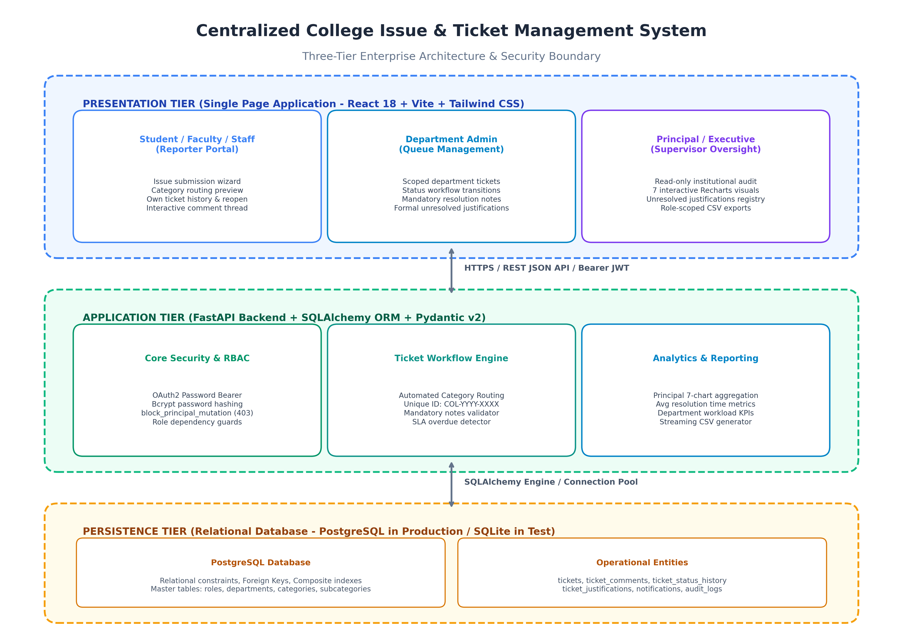
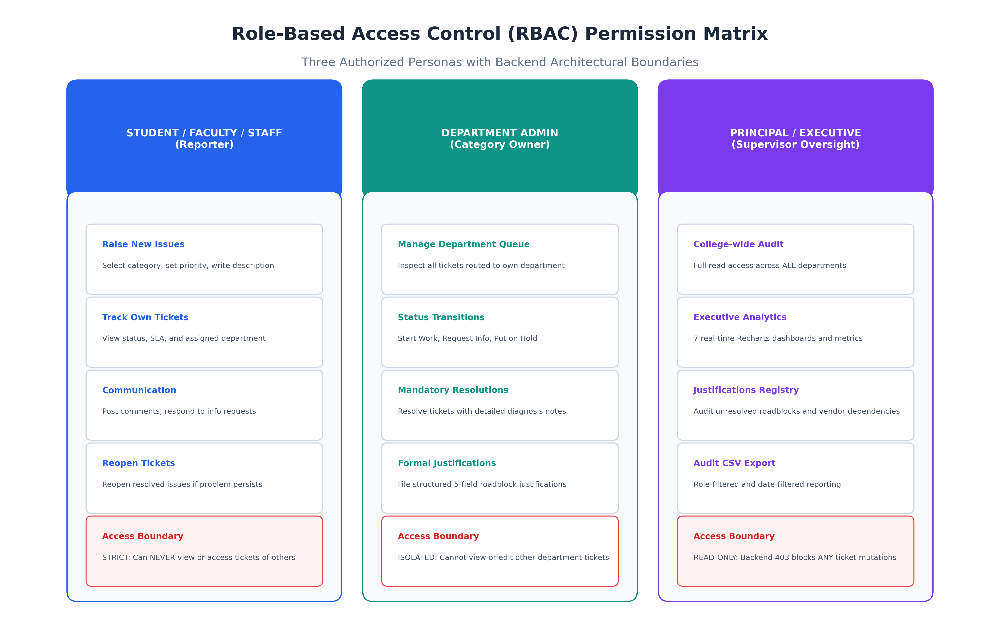
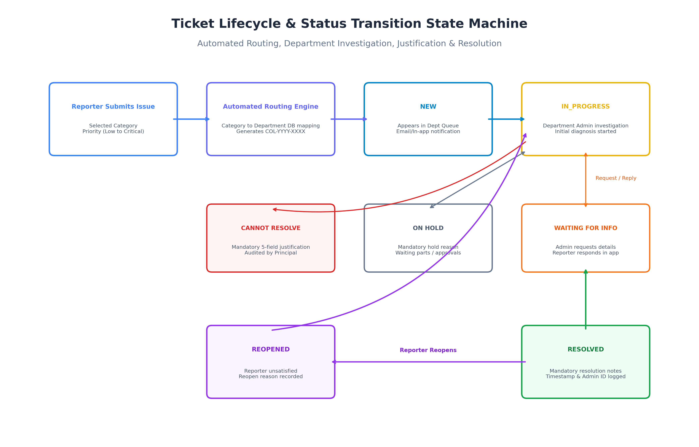
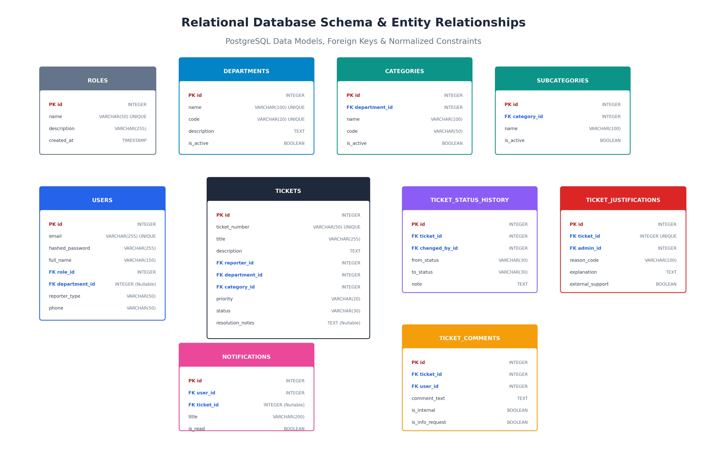

# 🎓 Centralized College Issue and Ticket Management System

[](https://college-issue-management-murex.vercel.app/login)
[](https://college-issue-backend-t72o.onrender.com/)
[](https://college-issue-backend-t72o.onrender.com/docs)
[](https://college-issue-backend-t72o.onrender.com/health)

A production-ready, full-stack enterprise issue tracking and resolution management platform designed specifically for higher educational institutions. The platform empowers students, faculty, and administrative staff to submit issues, routes tickets automatically to responsible department queues via a database-driven category engine, enforces strict Role-Based Access Control (RBAC), and delivers real-time executive analytics to college leadership.

---

## 🌐 Live Deployments

| Component | Service | URL | Status |
|---|---|---|---|
| **Production Web Application** | Vercel (React + Vite SPA) | [https://college-issue-management-murex.vercel.app](https://college-issue-management-murex.vercel.app/login) |  |
| **REST API Backend** | Render (FastAPI + Uvicorn) | [https://college-issue-backend-t72o.onrender.com](https://college-issue-backend-t72o.onrender.com/) |  |
| **Swagger Interactive Docs** | OpenAPI / Swagger UI | [https://college-issue-backend-t72o.onrender.com/docs](https://college-issue-backend-t72o.onrender.com/docs) |  |
| **Health Check Endpoint** | Production DB & App Health | [https://college-issue-backend-t72o.onrender.com/health](https://college-issue-backend-t72o.onrender.com/health) |  |

---

## 🏛️ Problem Statement & System Overview

In traditional college campuses, maintenance, administrative, financial, and academic issues are reported through informal emails, WhatsApp messages, paper chits, and verbal requests. This results in:
- **Lost and Unaddressed Complaints**: No formal tracking or status accountability.
- **Delayed Turnaround Times**: Issues bounce between departments without ownership.
- **Lack of Institutional Transparency**: Students and faculty have no visibility into issue progress.
- **Zero Executive Visibility**: College Principals and Deans lack unified metrics on campus infrastructure health and department resolution performance.

### The Solution
This platform establishes a **centralized, transparent, and immutable digital workflow**:
1. **Automated Category Routing**: Issue categories (*Wi-Fi / Internet*, *Fee Payment*, *Classroom Maintenance*, *Course Registration*) map directly to responsible departments (*IT*, *Finance*, *Infrastructure*, *Academics*).
2. **Transparent Ticket Lifecycle**: Full status management through `NEW`, `IN_PROGRESS`, `WAITING_FOR_INFO`, `ON_HOLD`, `RESOLVED`, `CLOSED`, and `REOPENED`.
3. **Mandatory Resolution Accountability**: Department administrators cannot resolve tickets without entering detailed resolution descriptions.
4. **Structured Unresolved Justifications**: If budget constraints, vendor delays, or administrative barriers prevent resolution, departments must submit a formal 5-point justification reviewed by the Principal.
5. **Supervisor Executive Oversight**: The Principal has college-wide read access to audit all tickets, departments, and 7 live Recharts analytics dashboards, while **backend APIs strictly block mutations with HTTP 403 Forbidden**.

---

## 🏗️ System Architecture

The application is deployed across modern cloud infrastructure with complete decoupling of client presentation, API processing, and managed persistence.



### Architectural Flow
1. **Vercel Edge Network**: Delivers the compiled React + Vite SPA with global CDN caching and client-side SPA routing rewrites.
2. **Render Web Service**: Runs an asynchronous FastAPI backend under Uvicorn, binding to `0.0.0.0` and dynamic cloud ports with CORS middleware.
3. **Managed PostgreSQL**: Hosts relational tables with foreign keys, composite indexes, connection pooling (`pool_recycle=300`, `pool_pre_ping=True`), and Alembic version-controlled migrations.

---

## 💻 Technology Stack

### Frontend
- **Framework**: React 18 (Vite SPA)
- **Styling**: Tailwind CSS with dark/light visual contrast and custom badges
- **Routing**: React Router v6 with declarative role-based route guards
- **Data Visualizations**: Recharts (Donut, Bar, Stacked Bar, Line, Pie charts)
- **HTTP Client**: Axios with automatic Bearer JWT injection and 401 interceptors
- **Icons**: Lucide React

### Backend
- **Framework**: FastAPI (Python 3.11) with async routing
- **ORM / Persistence**: SQLAlchemy 2.0 with connection pooling and PostgreSQL dialects
- **Migrations**: Alembic with auto-upgrade on startup
- **Database Driver**: `psycopg2-binary` (enforced via `postgresql+psycopg2://` driver scheme)
- **Validation & Serialization**: Pydantic v2 schemas
- **Security & Cryptography**: OAuth2 Password Bearer, PyJWT (HS256), Passlib (Bcrypt hashing)
- **Server**: Uvicorn ASGI Server

---

## 👥 User Roles & Permissions Matrix



### 1. Student / Faculty / Staff (Reporter)
- **Scoped Portal**: Submits new issues through a 3-step structured wizard with category auto-routing preview.
- **Ticket Tracking**: Real-time progress monitoring, assigned department visibility, and SLA tracking.
- **Two-Way Communication**: Post comments and provide additional information requested by department officers.
- **Issue Reopening**: Can reopen resolved tickets if the problem reoccurs or was unsatisfactorily handled.
- **Data Boundary**: Isolated strictly to their own submitted tickets.

### 2. Department Administrator (Category Owner)
- **Department Queue**: Manages department-specific ticket queues (*New*, *In Progress*, *Waiting for Info*, *On Hold*, *Resolved*, *Overdue*).
- **Workflow Actions**:
  - *Start Work*: Transitions ticket to `IN_PROGRESS`.
  - *Request Information*: Prompts reporter for details; sets status to `WAITING_FOR_INFO`.
  - *Place On Hold*: Temporarily pauses SLA with mandatory recorded reason.
  - *Resolve Ticket*: Requires mandatory resolution notes (minimum 10 characters).
  - *Formal Justification*: Submits structured justification to the Principal if resolution is blocked.
- **Internal Staff Notes**: Post private internal remarks invisible to the reporter.
- **Data Boundary**: Isolated to their assigned department. Cannot modify other departments' tickets.

### 3. Principal (College-Wide Executive Supervisor)
- **Executive Oversight**: Centralized bird's-eye view across all departments, categories, and campus tickets.
- **Read-Only Enforcement**: Can inspect all tickets, status history, justifications, and comments, but **backend APIs strictly reject any create, update, assign, or delete mutations with HTTP 403 Forbidden**.
- **7 Live Interactive Analytics Dashboards**:
  1. *Resolution Overview*: Donut chart (Resolved vs In Progress vs On Hold vs Pending).
  2. *Issues by Department*: Bar chart comparing departmental workload.
  3. *Issue Trends*: 30-day reporting volume line chart.
  4. *Most Reported Categories*: Horizontal bar chart identifying frequent complaints.
  5. *Department-wise Ticket Status*: Stacked bar chart comparing resolution status per department.
  6. *Average Resolution Time*: Performance benchmark across departments.
  7. *Priority Distribution*: Donut chart showing ticket severity breakdown.
- **Formal Justifications Audit**: Dedicated interface reviewing unresolved roadblock justifications.
- **Audit CSV Exports**: Download role-filtered CSV reports.

---

## 🔄 Ticket Lifecycle & Workflow

The platform maintains a deterministic state machine for ticket transitions with full historical auditing.



```
[ NEW ] ─────────────────────────► [ IN_PROGRESS ] ──────────────► [ RESOLVED ] ────► [ CLOSED ]
   │                                     ▲   │                           ▲
   │                                     │   │                           │
   ├──► [ WAITING_FOR_INFO ] ────────────┤   └──► [ ON_HOLD ] ───────────┘
   │            │                        │              │
   │            └────────────────────────┘              │
   │                                                    ▼
   └──────────────────────────────────────────► [ UNRESOLVED JUSTIFICATION ]
                                                        ▲
[ REOPENED ] ◄──────────────────────────────────────────┘
```

Every status transition records:
- Timestamp (UTC)
- Actor ID & Full Name
- Previous Status & New Status
- Reason / Transition Note

---

## 🗄️ Database Design

The database schema is normalized and indexed for relational integrity, query performance, and audit compliance.



### Key Entities
- **`users`**: User identity, hashed passwords, department affiliation, and foreign key to `roles`.
- **`roles`**: System roles (`reporter`, `department_admin`, `principal`).
- **`departments`**: Academic and administrative departments (IT, Finance, Infra, Academics, Library, Hostel, Transport, HR).
- **`categories`**: Top-level issue categories linked directly to a target `department_id`.
- **`subcategories`**: Granular classifications under each category.
- **`tickets`**: Core ticket record with generated sequence numbers (`COL-YYYY-NNNN`), title, description, priority enum, status enum, SLA timestamps, and resolution notes.
- **`ticket_comments`**: Public communications and private internal notes.
- **`ticket_status_history`**: Immutable transition audit log.
- **`ticket_justifications`**: 5-point formal justifications for unresolved tickets.

---

## 📸 Visual Assets & Documentation

All architectural and database diagrams are maintained in `project_documentation/`:

| Diagram | Description | File |
|---|---|---|
| **System Architecture** | Cloud deployment architecture and network tiers | [`project_documentation/System_Architecture.png`](project_documentation/System_Architecture.png) |
| **Ticket Workflow** | State transition machine and SLA pathways | [`project_documentation/Ticket_Workflow.png`](project_documentation/Ticket_Workflow.png) |
| **Role-Based Access** | Security boundary flowchart across roles | [`project_documentation/Role_Based_Access_Flowchart.png`](project_documentation/Role_Based_Access_Flowchart.png) |
| **Database ERD** | Entity-Relationship diagram with relationships | [`project_documentation/Database_ER_Diagram.png`](project_documentation/Database_ER_Diagram.png) |

---

## 🛠️ Local Installation & Setup

### Prerequisites
- Python 3.10+
- Node.js 18+ and npm
- PostgreSQL 14+ (or SQLite for local testing)
- Git

### 1. Clone the Repository
```bash
git clone https://github.com/varshini200502/college-issue-management.git
cd college-issue-management
```

### 2. Backend Setup
```bash
cd backend

# Create and activate virtual environment
python -m venv venv
# Windows:
venv\Scripts\activate
# Linux/macOS:
source venv/bin/activate

# Install dependencies
pip install -r requirements.txt

# Configure environment variables
cp .env.example .env
# Edit .env with your local database URL and random SECRET_KEY

# Run database migrations
alembic upgrade head

# Seed initial master data, roles, and sample tickets
python seed.py

# Start development server
uvicorn app.main:app --host 127.0.0.1 --port 8000 --reload
```
Backend API will be accessible at `http://127.0.0.1:8000`. Swagger documentation is available at `http://127.0.0.1:8000/docs`.

### 3. Frontend Setup
```bash
cd ../frontend

# Install dependencies
npm install

# Configure environment variables
cp .env.example .env
# Set VITE_API_BASE_URL="http://localhost:8000"

# Start Vite dev server
npm run dev
```
Frontend will be available at `http://localhost:5174`.

### 4. Running the Automated Test Suite
From the `backend` directory:
```bash
python test_suite.py
```
This executes the 9-point integration test suite verifying authentication, ticket creation, department routing, resolution enforcement, role isolation, formal justifications, principal 403 restrictions, analytics aggregation, and CSV exports.

---

## 🔒 Security & Deployment Safeguards

- **Zero Secret Commits**: Real `.env` files, credentials, and tokens are strictly excluded by `.gitignore`. Templates are maintained in `.env.example`.
- **No SQLite in Production**: `backend/app/core/database.py` contains runtime guards that disallow SQLite and localhost fallback in production environments.
- **Production Demo Accounts Disabled**: Demo credential helpers on the login page are conditionally compiled only in `import.meta.env.DEV` and automatically stripped from production builds.
- **CORS Protection**: Backends enforce explicit origin validation including production Vercel domains and reject unauthorized origins.
- **Idempotent Seeding**: `seed.py` checks existing records before insertion, ensuring subsequent startups never create duplicate records.

---

## 📄 License
This project is developed for institutional ticket and issue governance. All rights reserved.
